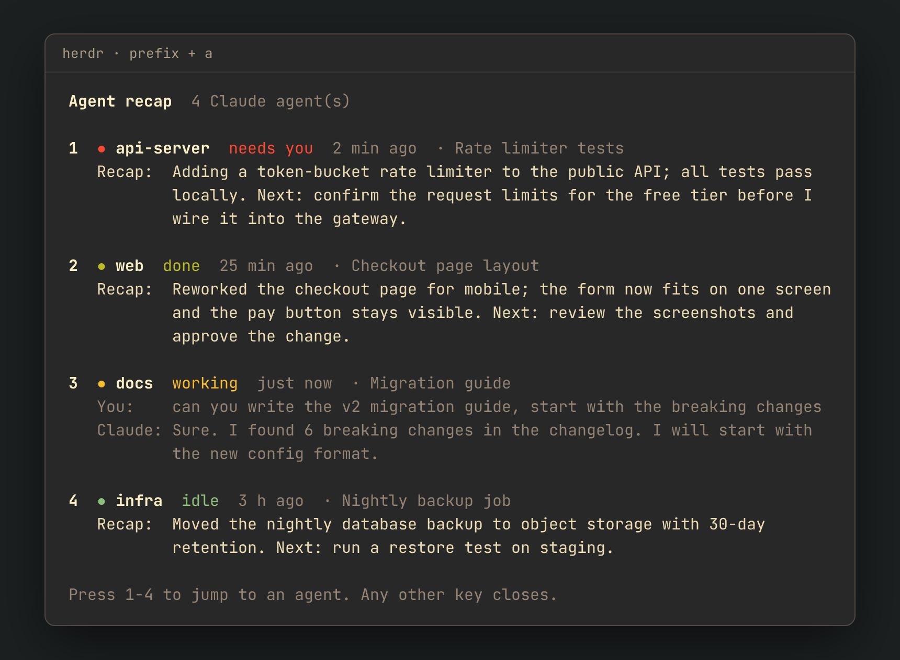

# herdr-recap

A [herdr](https://herdr.dev) plugin that answers "what was that agent doing again?"

Press one key and a popup lists every Claude Code agent in your herdr session,
with a short recap of what it was working on and what comes next.



<sub>Demo data. Rebuild the picture with `docs/make_demo.py`.</sub>

- Agents that need you come first, then done, working, and idle ones.
- Press a number to jump to that agent's pane.
- No AI calls and no cost. It reads the recap that Claude Code already writes
  into its chat file after you step away. When there is no recap yet, or it is
  older than your last message, it shows your last request and Claude's last
  reply instead.

## Install

```bash
herdr plugin install homur/herdr-recap
herdr integration install claude      # lets herdr match each pane to its chat
```

Then bind a key in `~/.config/herdr/config.toml` (herdr binds no plugin keys
by default) and reload:

```toml
[[keys.command]]
key = "prefix+a"
type = "plugin_action"
command = "homur.recap.open"
description = "agent recap"
```

```bash
herdr server reload-config
```

Now press `prefix` then `a`.

## Requirements

- herdr 0.9.0 or newer
- Claude Code
- `python3` (standard library only)
- Linux or macOS. Tested on Linux (WSL2).

## How it works

1. Lists herdr panes running Claude Code (`herdr pane list`).
2. Finds each pane's chat file through the session id that herdr's Claude
   integration reports. Chats started before the integration was installed
   fall back to the newest chat file for that folder.
3. Reads the latest `away_summary` recap, your last message, and Claude's
   last reply from `~/.claude/projects/` (or `$CLAUDE_CONFIG_DIR/projects/`).

Nothing is sent anywhere. The plugin only reads local files.

## Troubleshooting

**"no chat history found"** — herdr cannot link that pane to a chat yet. Run
`herdr integration install claude`, then restart Claude in that pane.

**No recap line** — Claude Code writes recaps only after you have been away
from a chat for a while, and only when recaps are on (`/config` in Claude Code).

**Key does nothing** — check that the plugin is enabled and the action exists:

```bash
herdr plugin list
herdr plugin action list --plugin homur.recap
herdr plugin log list --plugin homur.recap
```

## License

MIT
